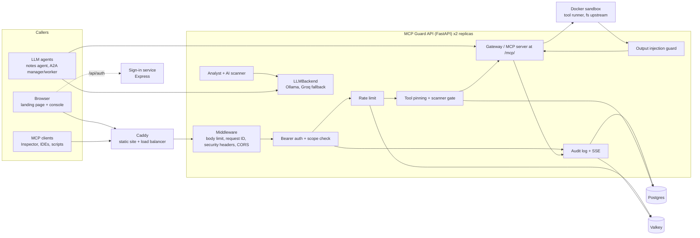
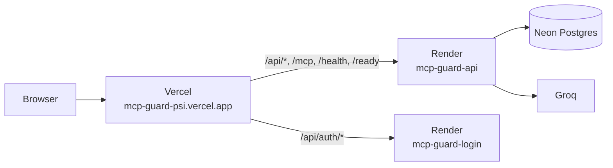

# MCP Guard

MCP Guard is a security gateway for [Model Context Protocol](https://modelcontextprotocol.io) (MCP) tools. It is a FastAPI service that hosts an MCP server at `/mcp/` and a REST API, and every request has to get past a scoped API key check, tool pinning, a tool-poisoning scanner and a prompt-injection check on tool output before anything comes back to the caller. Tools run in a locked-down Docker container, and every decision lands in an append-only audit log. Most MCP servers trust anyone who can reach them. We wanted one place that decides who is calling, which tools they can touch and whether a tool's description or output is trying to manipulate the model, and then we put our own LLM agents behind the same checks so an agent only gets what its key allows.

<p align="center">
  
</p>

The diagram loops through three cases: a key with the right scope reaches the tool, a request with no key stops at auth with a 401, and a valid key without the needed scope stops at the scope check with a 403.

## Contents

- [Live deployment](#live-deployment)
- [Features](#features)
- [Architecture](#architecture)
- [Tech stack](#tech-stack)
- [Quick start (Docker Compose)](#quick-start-docker-compose)
- [Local development without Docker](#local-development-without-docker)
- [Commands](#commands)
- [Configuration](#configuration)
- [API and scopes](#api-and-scopes)
- [Deploying for free](#deploying-for-free)
- [Project structure](#project-structure)
- [Documentation](#documentation)
- [Security notes](#security-notes)
- [Team](#team)
- [License](#license)

## Live deployment

| Part | URL | Host |
| --- | --- | --- |
| Landing page and console | https://mcp-guard-psi.vercel.app | Vercel |
| API and MCP endpoint | https://mcp-guard-api.onrender.com | Render (free web service) |
| Sign-in service | `mcp-guard-login` on Render | Render (free web service) |
| Database | Neon Postgres | Neon (free) |
| LLM | Groq | Groq (free key) |

The browser only talks to the Vercel site. [`frontend/vercel.json`](frontend/vercel.json) forwards `/api/*`, `/mcp`, `/health` and `/ready` to the API on Render and `/api/auth/*` to the sign-in service, so the whole thing runs on one origin. Open `/console` on the site and paste an API key to use the console.

The hosted copy is a demo and is missing some features on purpose:

- **No tool execution.** Render has no Docker daemon, so the sandbox is not available there. Production mode refuses to run tools inside the API process, so calls to `list_notes`, `read_note` and `write_note` fail closed with a 503. The `fs_*` filesystem tools are switched off, and the notes agent, A2A tasks and the Attack Simulator steps that run a tool do not work either.
- **Groq instead of Ollama.** There is no local model on Render. Each LLM call tries Ollama first, fails straight away and falls back to Groq.
- **The API sleeps.** Render free services go to sleep after about 15 minutes with no traffic. The first request after that can take up to a minute while it wakes up, so open `/health` first if you are about to show it to someone.
- **Short-lived state.** Sign-in accounts live in memory and reset when the sign-in service sleeps or restarts. Notes on the API disk reset on every restart.
- **120 second limit.** Vercel cuts off a forwarded request after 120 seconds, so scanning every tool with the AI scanner in one go can time out. Scan one tool at a time.

What does work on the hosted copy: sign up and sign in, the console, API keys, the audit log and live audit stream, tool pinning, the rule scanner and AI scanner, Guard Events, the AI analyst and the LLM calls page.

Everything, including the sandbox, the filesystem tools, the agents, Valkey and the load balancer, runs locally with Docker Compose. See the [quick start](#quick-start-docker-compose).

## Features

**Gateway auth with scoped API keys.** Protected REST routes and `/mcp/` need `Authorization: Bearer mcpg_...`. Keys are shown once when created, and only an 8-character prefix plus an HMAC-SHA256 hash (keyed with a server pepper) is stored. Each key carries scopes such as `notes:read`, `agent:run`, `audit:read` or `admin`. Every REST route has to appear in the route-to-scope map in [`api/app/auth/scopes.py`](api/app/auth/scopes.py), or the app refuses to start. Missing, malformed and unknown keys all get the same 401, so the response can't be used to probe for valid keys.

**Tool pinning.** Each tool's name, description and input schema are hashed into a fingerprint. With `TOOL_PINNING_MODE=enforce`, a tool only runs after an admin approves that fingerprint, and unapproved tools are hidden from `tools/list`. If a description or schema changes later, that is drift: the tool is blocked again until someone reviews and re-approves it. This is the defence against a server quietly swapping a tool definition after you trusted it.

**Tool-poisoning scanner, rules plus AI.** The rule scanner (R1 to R6) checks tool descriptions and schemas for prompt-injection phrases, exfiltration domains, overbroad parameters, oversized descriptions or schemas, suspicious parameter descriptions and odd tool names. Findings at `high` or `critical` block the tool when pinning is enforced. An optional AI pass (`SCANNER_AI_ENABLED`) asks the LLM to look for subtler poisoning that keyword rules miss. The model can only add findings, never clear a rule finding, and AI findings are capped below `critical`. If the model is down, the tool is marked as not checked rather than safe. See [docs/AI_SCANNER.md](docs/AI_SCANNER.md).

**Prompt-injection guard on tool output.** Tool results are checked before they reach the caller for instruction overrides, fake system prompts, requests for keys or credentials, encoded payloads, exfiltration links and delimiter tricks (rules G1 to G6). In `enforce` mode a high-risk result is withheld and medium-risk text is cleaned, and each hit is written to the audit log as a `tool.output.injection` event. Production refuses `INJECTION_GUARD_MODE=off`.

**Sandboxed tool runner.** Tools run in a fresh Docker container with a read-only root filesystem, no capabilities, no network, a non-root user and limits on memory, CPU, process count and file size. The container only sees the notes folder. If Docker or the runner image is missing, the call fails with a 503 instead of running inside the API. The official MCP filesystem server can be added as `fs_*` tools, each call in its own container. See [docs/UPSTREAM_FILESYSTEM.md](docs/UPSTREAM_FILESYSTEM.md).

**Audit log.** Every auth decision and tool call is written to `audit_events`, with a hash of the arguments instead of their values. Writes and MCP `tools/call` are audit-first: the row is written before the tool runs. On Postgres a trigger blocks UPDATE, DELETE and TRUNCATE on the table, apart from the retention job. `GET /api/audit/stream` pushes events live over SSE.

**A2A manager and worker agents.** `POST /api/a2a/tasks/run` runs a LangGraph manager that hands a notes task to a worker agent. The server narrows the worker's scopes to what the manager actually holds, signs the delegation with HMAC-SHA256 and the worker rejects anything invalid, expired or tampered with. The worker reaches tools only through `/mcp/` with its own key, so every gateway check still applies. This is a one-hop delegation that uses the task and agent-card shapes from the `a2a-sdk` package; it is not a full A2A protocol server. See [docs/A2A_EXECUTION.md](docs/A2A_EXECUTION.md).

**Notes agent.** `POST /api/agents/notes/run` runs a LangGraph agent that calls MCP Guard's own `/mcp/` endpoint with its own key. A 401, 403 or 429 from the gateway stops the run.

**AI security analyst.** Audit denials, output-injection events and open scanner findings are grouped into incidents by ordinary code. `POST /api/analyst/explain` asks the model to explain one incident in plain English. Every line of the timeline has to cite a real event, and a reply that fails validation is not shown. The analyst never blocks, revokes or approves anything. See [docs/AI_ANALYST.md](docs/AI_ANALYST.md).

**Console.** The React console at `/console` reads the real API with the key you paste in. Views: Overview, Live Audit, AI Analyst, Agents, LLM Calls, Metrics, Tool Pinning, Scanner, Sandbox, Guard Events, Attack Simulator and API Keys. The Attack Simulator sends real bad keys, wrong scopes and request bursts at the gateway. When the API is unreachable, the console says so and shows the last real data it had, never made-up demo data. See [docs/CONSOLE.md](docs/CONSOLE.md).

**Rate limiting.** Each API key has one token bucket (30 tokens, refilling at 5 per second by default) shared by REST and `/mcp`. A limited request gets 429 with `Retry-After`. Repeated failed logins from one IP are throttled separately.

**Load balancing.** The Compose stack runs two API replicas behind Caddy. MCP traffic is routed by the `Authorization` header so a client keeps landing on the replica that holds its MCP session, and REST traffic goes to the replica with the fewest connections. Valkey holds the shared rate-limit bucket and relays audit events, so a client watching the live stream on one replica still sees writes made on the other. See [docs/LOAD_BALANCING.md](docs/LOAD_BALANCING.md).

The LLM is never the final security authority. Auth, scope checks, fingerprint comparisons, scanner rules and the output guard are plain code. A model can explain something or flag it for a person, but it can't grant a scope, approve a changed schema or switch off a check, and enforcement keeps working when the model is down.

## Architecture



The agents run inside the API process, but they call `/mcp/` over HTTP with their own keys, so they go through the same auth, pinning, sandbox and guard as any outside client.

On the hosted copy, Vercel takes the place of Caddy, there is one API instance on Render with no Valkey and no sandbox, Neon provides Postgres and Groq is the only working model.



## Tech stack

| Area | Used |
| --- | --- |
| API | Python 3.11+, FastAPI, Uvicorn, the official MCP Python SDK (FastMCP, Streamable HTTP) |
| Data | SQLAlchemy 2 (async), Alembic, Postgres 16 (SQLite for local development), asyncpg |
| Shared state | Valkey 8 (Redis-compatible) |
| Agents and LLM | LangGraph, LangChain with ChatOllama (`qwen3.5:9b`) and ChatGroq (`openai/gpt-oss-120b`) as fallback, `a2a-sdk` types |
| Sandbox | Docker containers started per tool call |
| Frontend | React 19, Vite 8, Tailwind CSS 4, TanStack Query, React Router |
| Sign-in service | Node 22, Express, bcrypt, JWT, Google sign-in |
| Proxy | Caddy 2 |
| Hosting (demo) | Vercel, Render, Neon, Groq |
| Tooling | uv for Python, npm for the frontend |

## Quick start (Docker Compose)

This is the full stack: Postgres, Valkey, a one-shot migration job, two API replicas and Caddy serving the site and balancing the API. You need Docker with Compose, and [uv](https://docs.astral.sh/uv/) only if you want to run scripts outside the containers.

**1. Configure.** Copy the template and replace the placeholders. `POSTGRES_PASSWORD`, `REDIS_PASSWORD` and `API_KEY_PEPPER` are required, and Compose will not start without them.

```bash
git clone https://github.com/aneek22112007-tech/mcp-a2a-secure.git
cd mcp-a2a-secure
cp .env.compose.example .env
# generate values with: openssl rand -hex 32
```

Keep `POSTGRES_PASSWORD` hex, because it is placed inside the database URL. Never commit `.env`.

**2. Build the sandbox images and start the stack.**

```bash
./api/scripts/build_sandbox_image.sh
./api/scripts/build_upstream_fs_image.sh
docker compose up -d --build
docker compose ps
```

When it is up, `postgres`, `valkey`, `api1`, `api2` and `proxy` show as healthy, and `migrate` and `notes-init` have exited with code 0. Everything is served at http://127.0.0.1:8000.

```bash
curl http://127.0.0.1:8000/health
# {"status":"ok","app":"MCP Guard"}
```

**3. Create an admin key and approve the built-in tools.** Compose enforces tool pinning, so nothing runs until it is approved.

```bash
docker compose exec api1 python scripts/create_admin_key.py
docker compose exec api1 python scripts/approve_current_tools.py
```

The key is printed once. Keep it in a password manager. Filesystem tools are not approved by the script. Sync them with `POST /api/pins/sync` and approve each one you want through the Tool Pinning view or `POST /api/pins/{tool_name}/approve`.

**4. Open the console** at http://127.0.0.1:8000/console and paste the admin key.

**5. Turn on the LLM features (optional).** The agents, the AI scanner and the analyst need a model. Install [Ollama](https://ollama.com) on the host, pull the model and load it into memory before the first request so the first call doesn't time out:

```bash
ollama pull qwen3.5:9b
curl http://localhost:11434/api/generate -d '{"model":"qwen3.5:9b","keep_alive":"30m"}'
```

Then set these in `.env` and run `docker compose up -d` again:

```bash
LLM_ENABLED=true
SCANNER_AI_ENABLED=true
GROQ_API_KEY=            # optional, used only if Ollama can't be reached or times out
NOTES_AGENT_API_KEY=     # mcpg_ key with agent:run, for the notes agent
WORKER_NOTES_API_KEY=    # mcpg_ key for the A2A worker
A2A_SIGNING_KEY=         # openssl rand -hex 32, same value on every replica
```

The containers reach Ollama at `http://host.docker.internal:11434`. Without a running Ollama, every call goes to Groq if a key is set.

**Sign-in pages (optional).** `/signin` and `/signup` use the separate Express service in `backend/`, which is not part of Compose. Run it with `cd backend && cp .env.example .env && npm install && npm start` (port 5001). The console does not need it.

The API containers mount `/var/run/docker.sock` so they can start sandbox containers. That gives them control of the host's Docker daemon, so only run this stack on a machine you trust.

## Local development without Docker

For working on the code, the API runs with uv and SQLite. You need Python 3.11+, uv and Node 20.19+ or 22.12+.

```bash
cd api
cp .env.example .env              # set API_KEY_PEPPER; SANDBOX_MODE=inprocess if Docker isn't running
uv sync
uv run alembic upgrade head       # creates the SQLite database in api/data/
uv run python scripts/seed_dev.py # optional: dev clients, no keys
uv run python scripts/create_admin_key.py
uv run uvicorn app.main:app --reload --host 127.0.0.1 --port 8000 --log-config log_config.json
```

In a second terminal:

```bash
cd frontend
npm install
npm run dev                       # http://localhost:5173, console at /console
```

`SANDBOX_MODE=inprocess` runs tools inside the API process. It is only allowed when `ENVIRONMENT` is `dev`, `development`, `local` or `test`. Swagger UI is at `/docs` in development only. Use `127.0.0.1` or `localhost` for MCP calls; other `Host` headers get a 421 from the MCP SDK's DNS rebinding protection.

To try the tools without auth, run the MCP server over stdio with MCP Inspector:

```bash
cd api
npx @modelcontextprotocol/inspector uv run python -m app.mcp_server
```

## Commands

| What | Command |
| --- | --- |
| Start the full stack | `docker compose up -d --build` |
| Check service health | `docker compose ps` |
| Stop the stack | `docker compose down` |
| Follow API logs | `docker compose logs -f api1 api2` |
| Restart one replica | `docker compose restart api1` |
| Build the sandbox runner image | `./api/scripts/build_sandbox_image.sh` |
| Build the filesystem upstream image | `./api/scripts/build_upstream_fs_image.sh` |
| Create the admin key | `docker compose exec api1 python scripts/create_admin_key.py` |
| Approve current built-in tools | `docker compose exec api1 python scripts/approve_current_tools.py` |
| Run the notes agent (from `api/`) | `uv run python scripts/run_notes_agent.py "List the notes"` |
| Run an A2A task (from `api/`) | `MANAGER_API_KEY=... API_BASE_URL=http://127.0.0.1:8000 uv run python scripts/run_a2a_task.py "list my notes"` |
| Prune old audit rows (from `api/`) | `uv run python scripts/prune_audit.py` |
| Demo scripts (from `api/`) | `./scripts/demo_tool_pinning.sh`, `demo_scanner.sh`, `demo_sandbox.sh`, `demo_audit.sh` |
| Apply migrations (local) | `cd api && uv run alembic upgrade head` |
| Frontend dev server | `cd frontend && npm run dev` |

## Configuration

The API reads `api/.env` locally and the root `.env` under Compose. Templates: [`api/.env.example`](api/.env.example) and [`.env.compose.example`](.env.compose.example). These are the settings you are most likely to touch; [docs/RUNBOOK.md](docs/RUNBOOK.md) lists all of them.

| Variable | Default | What it does |
| --- | --- | --- |
| `ENVIRONMENT` | `dev` | Anything other than `dev`, `development`, `local` or `test` is treated as production, which turns on stricter checks and turns off `/docs` |
| `DATABASE_URL` | SQLite in `api/data/` | Async SQLAlchemy URL. Hosted Postgres strings with `sslmode` and `channel_binding` are accepted |
| `API_KEY_PEPPER` | none | Secret used to hash API keys. Required in production. Changing it invalidates every key |
| `CORS_ORIGINS` | `["http://localhost:5173"]` | JSON list of allowed browser origins |
| `MCP_ALLOWED_HOSTS` / `MCP_ALLOWED_ORIGINS` | `[]` | JSON lists of extra `Host` and `Origin` values `/mcp` accepts, on top of the local defaults. Set them when the API sits behind a hosted proxy |
| `TOOL_PINNING_MODE` | `off` (`enforce` in production) | `off`, `warn` or `enforce` |
| `INJECTION_GUARD_MODE` | `enforce` in production | `off`, `warn` or `enforce`. `off` is refused in production |
| `SANDBOX_MODE` | `docker` | `docker`, or `inprocess` for development only |
| `UPSTREAM_FS_ENABLED` | `false` | Register the official filesystem MCP server as `fs_*` tools |
| `RATE_LIMIT_CAPACITY` / `RATE_LIMIT_REFILL_RATE_PER_SEC` | `30` / `5.0` | Per-key token bucket |
| `REDIS_URL` | unset | Valkey or Redis URL for the shared bucket and audit relay |
| `MULTI_INSTANCE` | `false` | When true, startup refuses SQLite and a missing `REDIS_URL` |
| `LLM_ENABLED` | `false` | Turns on the agents and the analyst |
| `OLLAMA_BASE_URL` / `OLLAMA_MODEL` | `http://localhost:11434` / `qwen3.5:9b` | Primary model |
| `GROQ_API_KEY` / `GROQ_MODEL` | unset / `openai/gpt-oss-120b` | Fallback model, used only when Ollama can't be reached or times out |
| `SCANNER_AI_ENABLED` | `false` | Turns on the AI scanner pass. Needs `LLM_ENABLED=true` |
| `NOTES_AGENT_API_KEY` / `WORKER_NOTES_API_KEY` | unset | Keys the notes agent and A2A worker use against `/mcp/` |
| `A2A_SIGNING_KEY` | unset | HMAC key for delegation tokens. Without it each process makes a temporary key and logs a warning |
| `MCP_SELF_API_KEY` | unset | Key with `agent:run` used only by the `/api/status` probe |
| `AUDIT_RETENTION_DAYS` | `90` | How long audit rows are kept |
| `HSTS_MAX_AGE_S` | `0` | Set above 0 only once the server is behind HTTPS |

The frontend build reads `VITE_API_BASE_URL`. Don't put API keys in any `VITE_` variable; the console asks for the key at runtime and keeps it in `sessionStorage` for that tab.

## API and scopes

| Method | Path | Scope |
| --- | --- | --- |
| `GET` | `/health`, `/ready` | public |
| `GET` | `/api/status`, `/api/mcp/info` | public |
| `POST`, `GET`, `DELETE` | `/mcp/` | `agent:run` (plus the tool's own scope) |
| `GET` / `PUT` | `/api/notes`, `/api/notes/{name}` | `notes:read` / `notes:write` |
| `GET` | `/api/audit`, `/api/audit/stream` | `audit:read` |
| `GET` | `/api/metrics` | `metrics:read` |
| `GET` | `/api/sandbox/runs`, `/api/sandbox/runs/{run_id}`, `/api/sandbox/health` | `sandbox:read` |
| `GET` | `/api/pins`, `/api/pins/{tool_name}`, `/api/upstreams` | `tools:read` |
| `POST` | `/api/pins/sync`, `/api/pins/{tool_name}/approve`, `/api/pins/{tool_name}/revoke` | `admin` |
| `GET` | `/api/scanner/findings`, `/api/scanner/findings/{finding_id}` | `scanner:read` |
| `POST` | `/api/scanner/run`, `/api/scanner/run/{tool_name}`, `/api/scanner/findings/{finding_id}/resolve` | `admin` |
| `POST` | `/api/agents/notes/run` | `agent:run` |
| `POST` / `GET` | `/api/a2a/tasks/run`, `/api/a2a/tasks/{id}` | `agent:run` |
| `GET` | `/api/a2a/capabilities`, `/api/a2a/agent-card` | public |
| `GET` | `/api/analyst/status` | `analyst:run` |
| `GET` | `/api/analyst/incidents`, `/api/analyst/incidents/{incident_id}` | `audit:read` |
| `POST` | `/api/analyst/explain` | `analyst:run` and `audit:read` |
| `GET` | `/api/llm/health`, `/api/llm-calls` | `admin` |
| `POST` | `/api/guard/check` | `admin` |
| `POST`, `GET`, `DELETE` | `/api/keys`, `/api/keys/{key_id}` | `admin` |

Filesystem tools also need `files:read` or `files:write`, and the hostile lab tools need `lab:call`. `admin` passes every scope check.

A quick check against a running stack:

```bash
# no key: 401
curl -i http://127.0.0.1:8000/api/notes

# MCP initialize with a key that has agent:run
curl -i -X POST http://127.0.0.1:8000/mcp/ \
  -H "Authorization: Bearer $AGENT_KEY" \
  -H "Content-Type: application/json" \
  -H "Accept: application/json, text/event-stream" \
  -d '{"jsonrpc":"2.0","id":1,"method":"initialize","params":{"protocolVersion":"2025-06-18","capabilities":{},"clientInfo":{"name":"curl","version":"0"}}}'
```

## Deploying for free

The hosted demo runs on Vercel (frontend), Render (API and sign-in service, defined in [`render.yaml`](render.yaml)), Neon (Postgres) and Groq (LLM), with Upstash Redis as an optional extra. None of them need a credit card. In short:

1. Create a Neon project and copy its connection string.
2. On Render, create a Blueprint from this repo on the `deploy/free-tier` branch and fill in `DATABASE_URL`, `CORS_ORIGINS`, `MCP_ALLOWED_HOSTS`, `MCP_ALLOWED_ORIGINS` and `GROQ_API_KEY`. Render generates the pepper, signing key and JWT secret.
3. On Vercel, import the repo with `frontend` as the root directory and set `VITE_API_BASE_URL` to the site's own address.
4. From your laptop, run `create_admin_key.py` and `approve_current_tools.py` against Neon with the pepper from Render.

The full walkthrough, with troubleshooting, is in [docs/DEPLOY_FREE.md](docs/DEPLOY_FREE.md).

## Project structure

```text
mcp-a2a-secure/
├── api/                      FastAPI gateway and MCP server
│   ├── app/
│   │   ├── main.py           app setup, routers, /mcp mount, scope-map check
│   │   ├── auth/             key parsing and verification, scopes, MCP auth
│   │   ├── gateway.py        the single path from REST routes to tools
│   │   ├── mcp_server.py     FastMCP "mcp-guard" and the notes tools
│   │   ├── pins/             tool fingerprints, approval and drift checks
│   │   ├── scanner/          rule scanner (R1 to R6), AI scanner, scan gate
│   │   ├── guard/            prompt-injection guard for tool output (G1 to G6)
│   │   ├── sandbox/          Docker tool runner
│   │   ├── upstream/         filesystem and lab upstream servers
│   │   ├── agents/           notes agent and A2A manager/worker
│   │   ├── analyst/          incident grouping and explanations
│   │   ├── llm/              Ollama/Groq backend and call recording
│   │   ├── audit/            audit events, redaction, SSE
│   │   ├── models/, repos/   database models and queries
│   │   ├── routes/           REST endpoints
│   │   ├── rate_limit.py     per-key token buckets
│   │   └── config.py         settings and production checks
│   ├── alembic/              migrations
│   ├── sandbox/, docker/     runner and upstream images
│   ├── scripts/              admin key, tool approval, agents, demos
│   ├── Dockerfile
│   └── pyproject.toml
├── frontend/                 React landing page and console (src/console/)
├── backend/                  Express sign-in service
├── deploy/Caddyfile          load balancer and static site config
├── docs/                     design notes, guides and the threat model
├── docker-compose.yml        full local stack
├── render.yaml               Render Blueprint for the free deploy
└── .env.compose.example      Compose settings template
```

## Documentation

| Document | What's in it |
| --- | --- |
| [ARCHITECTURE_NOTES.md](docs/ARCHITECTURE_NOTES.md) | Design notes on how the pieces fit |
| [THREAT_MODEL.md](docs/THREAT_MODEL.md) | Trust boundaries, threats and the controls that exist in code |
| [MCP_IMPLEMENTATION.md](docs/MCP_IMPLEMENTATION.md) | How the MCP server and its tools are built |
| [DATA_MODEL.md](docs/DATA_MODEL.md) | Tables and relationships |
| [CONSOLE.md](docs/CONSOLE.md) | Running and using the live console |
| [AI_SCANNER.md](docs/AI_SCANNER.md) | Rule and AI tool-poisoning scanner |
| [AI_ANALYST.md](docs/AI_ANALYST.md) | Incident grouping and the analyst's safeguards |
| [A2A_EXECUTION.md](docs/A2A_EXECUTION.md) | Manager-to-worker delegation, scope attenuation and signing |
| [LOAD_BALANCING.md](docs/LOAD_BALANCING.md) | Caddy, two replicas and the shared Valkey state |
| [UPSTREAM_FILESYSTEM.md](docs/UPSTREAM_FILESYSTEM.md) | The official filesystem server as `fs_*` tools |
| [UPSTREAM_LAB.md](docs/UPSTREAM_LAB.md) | A deliberately hostile MCP server for testing the gateway (never in production) |
| [DEPLOY_FREE.md](docs/DEPLOY_FREE.md) | Free hosting on Vercel, Render, Neon and Groq |
| [RUNBOOK.md](docs/RUNBOOK.md) | Operations, every setting and troubleshooting |
| [PRIVACY.md](docs/PRIVACY.md) | What is stored and where data goes |
| [PERFORMANCE_BOTTLENECKS.md](PERFORMANCE_BOTTLENECKS.md) | Known performance limits |

## Security notes

- **Fail closed.** An unmapped route stops the app from starting. A missing sandbox gives a 503 rather than running the tool in the API. An unapproved or flagged tool gets a 403 when pinning is enforced.
- **Secrets stay out of storage and logs.** Only key hashes are stored. Logs record a deny reason or the key prefix, never the key. The audit log stores a hash of tool arguments, not the values. The LLM health endpoints never return the Groq key.
- **Strict request handling.** One `Authorization` header, ASCII only, `Bearer mcpg_...` up to 128 characters. Bodies are capped while streaming (413). Every response carries a strict CSP, `X-Frame-Options: DENY`, `nosniff`, `no-referrer` and `no-store`.
- **Append-only audit.** Database triggers block edits and deletes on `audit_events`, apart from the retention job. A database owner can still disable triggers, so production should connect as a non-owner role.
- **Proxy-aware IPs.** `X-Forwarded-For` is ignored unless `TRUSTED_PROXIES` is set, and then only trusted hops are skipped.
- **Production refuses unsafe settings.** A placeholder pepper, `SANDBOX_MODE=inprocess`, `INJECTION_GUARD_MODE=off`, the hostile lab and bootstrap tool approval are all rejected at startup.
- **Docker socket.** The Compose API containers mount the Docker socket to start sandbox containers, which gives them control of the host's Docker daemon.

The full threat model is in [docs/THREAT_MODEL.md](docs/THREAT_MODEL.md).

## Team

<table>
<tr>
<td align="center" width="180">
<a href="https://github.com/aneek22112007-tech"><br>Aneek Das</a><br><sub>@aneek22112007-tech</sub>
</td>
<td align="center" width="180">
<a href="https://github.com/codeslayerpdx"><br>Priyanshu Dwivedi</a><br><sub>@codeslayerpdx</sub>
</td>
</tr>
</table>

## License

[MIT](LICENSE)
